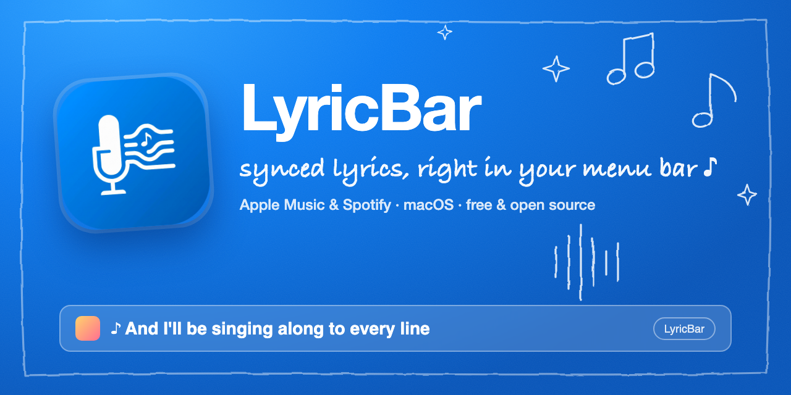
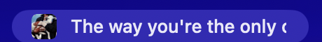
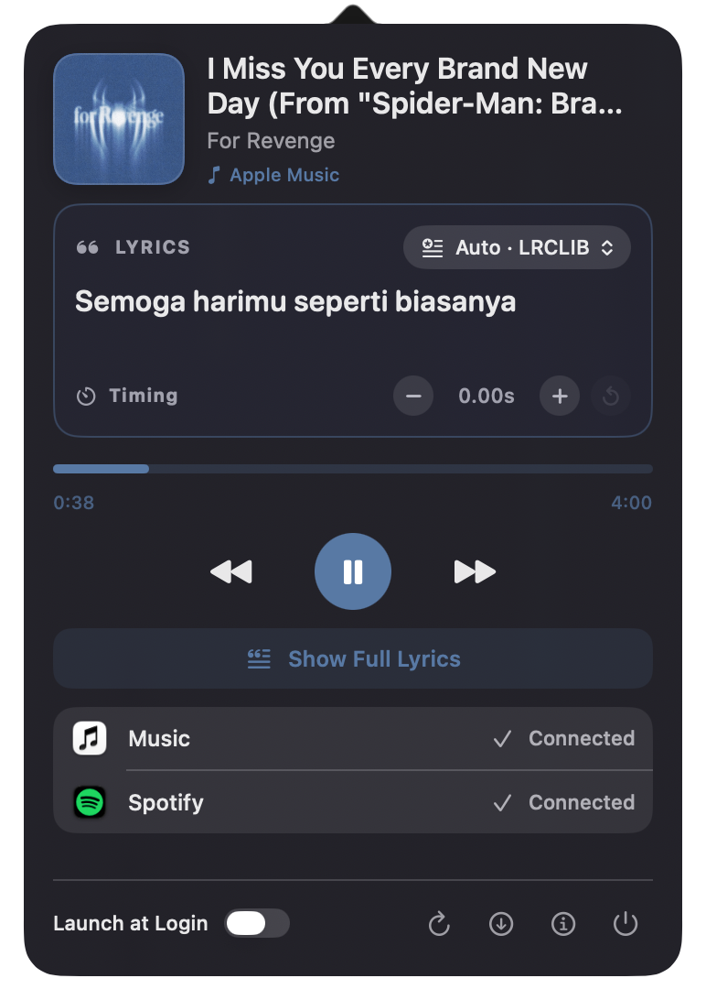
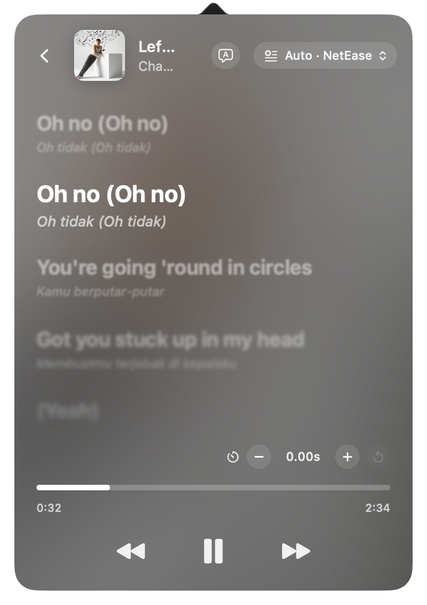

<p align="center">
  
</p>

<p align="center">
  <a href="https://github.com/rigelra15/LyricBar/releases/latest"></a>
  
  <a href="LICENSE"></a>
</p>

**LyricBar** is a lightweight macOS menu bar app that shows **synchronized lyrics** for whatever is playing in Apple Music or Spotify — the current line, with the album cover, always one glance away.

## Features

- **Live lyric sync** — the current line scrolls through your menu bar in time with the song
- **Album artwork** — compact cover in the menu bar, full song card in the popover
- **Apple Music & Spotify** — detects the playing app automatically
- **Full lyrics window** — Apple Music–style auto-scrolling view with an animated backdrop and instrumental-break dots
- **Multiple lyrics sources** — LRCLIB, NetEase and BetterLyrics, or *Auto* to try them in order
- **Playback controls** — previous, play/pause and next right from the popover
- **Offline cache** — fetched lyrics are stored locally for instant recall
- **Export** — save the current lyrics as an `.lrc` file
- **Menu bar only** — no Dock icon, no clutter
- **Launch at Login** — optional toggle in the popover
- **Built-in updates** — checks for new versions on launch and shows the changelog

## Using LyricBar

Once a song plays in Apple Music or Spotify, LyricBar shows the current line in the menu bar, with the album cover. Long lines scroll once across the item, then hold.

<p align="center">
  
</p>

Click it to open the popover.

<table>
  <tr>
    <td align="center" valign="top"></td>
    <td align="center" valign="top"></td>
  </tr>
  <tr>
    <td align="center"><sub><b>Popover</b> — song card, current line and controls</sub></td>
    <td align="center"><sub><b>Full lyrics</b> — auto-scrolling, current line in focus</sub></td>
  </tr>
</table>

What's in the popover:

| Control | What it does |
|---------|--------------|
| **Song card** | Cover, title, artist and which player it's coming from |
| **Lyrics source** (`Auto · LRCLIB`) | Pick LRCLIB, NetEase or BetterLyrics, or *Auto* to try them in order. If your pick has nothing for a song, LyricBar falls back to the others and shows it, e.g. `NetEase → LRCLIB` |
| **Timing** `−` `0.00s` `+` | `+` moves the lyrics ahead (lines show sooner), `−` holds them back; the arrow resets it. Saved per song |
| **Progress bar** | Shows the position in the track |
| **⏮ ⏯ ⏭** | Previous, play/pause and next |
| **Show Full Lyrics** | Opens the scrolling lyrics view; use **‹** to go back. Click a line to jump to it |
| **Music / Spotify** | *Connected* means LyricBar can read that player; otherwise click **Allow Access** |
| **Launch at Login** | Start LyricBar automatically when you sign in |
| ↻ **Clear cache** · ⬇︎ **Check for updates** · ⓘ **About** · ⏻ **Quit** | Footer buttons |

Between lines — an intro or instrumental break — the menu bar shows three dots that fill in as the break plays out.

## Install

Pick whichever you like. All of them install the same app.

### Homebrew

```bash
brew tap rigelra15/lyricbar https://github.com/rigelra15/LyricBar
brew install --cask lyricbar
```

On Homebrew 7+, third-party taps must be trusted first: run `brew trust rigelra15/lyricbar` if brew refuses to load the cask.

### One-line installer (curl)

```bash
curl -fsSL https://raw.githubusercontent.com/rigelra15/LyricBar/main/install.sh | bash
```

Need a specific version? `curl -fsSL …/install.sh | VERSION=1.0.23 bash`

### Download the DMG

1. Grab `LyricBar.*.dmg` from the [latest release](https://github.com/rigelra15/LyricBar/releases/latest)
2. Open it and drag **LyricBar** into **Applications**
3. LyricBar isn't notarized, so macOS may block the first launch. Either right-click the app → **Open** → **Open Anyway**, or run:
   ```bash
   xattr -dr com.apple.quarantine /Applications/LyricBar.app
   ```

The Homebrew and curl installers clear the quarantine flag for you.

### Build from source

```bash
git clone https://github.com/rigelra15/LyricBar.git
cd LyricBar
open LyricBar.xcodeproj   # then press ⌘R
```

## First launch

1. Open LyricBar — it lives in the menu bar.
2. Approve the **Automation** prompts for Music and/or Spotify so it can read the current track.
3. Play a song. Lyrics start syncing in the menu bar.

## Update

LyricBar checks GitHub for a new version every time it starts (including at login). When one is found you get the changelog and an **Update Now** button that downloads, installs and relaunches the app. You can also check manually with the ⬇︎ button in the popover.

Prefer the package manager?

```bash
brew upgrade --cask lyricbar
```

## Uninstall

**Homebrew**

```bash
brew uninstall --cask --zap lyricbar
```

**curl**

```bash
curl -fsSL https://raw.githubusercontent.com/rigelra15/LyricBar/main/uninstall.sh | bash
```

Add `KEEP_DATA=1` (`… | KEEP_DATA=1 bash`) to keep your cached lyrics and settings.

**By hand** — quit LyricBar, drag it from Applications to the Trash, and optionally delete:

```
~/Library/Application Support/LyricBarCache
~/Library/Caches/com.rigelra.LyricBar
~/Library/Preferences/com.rigelra.LyricBar.plist
```

If LyricBar was set to launch at login, also remove it under **System Settings → General → Login Items**.

## Requirements

| What | Details |
|------|---------|
| **macOS** | 26.5 (Tahoe) or later |
| **Mac** | Apple Silicon or Intel (universal build) |
| **Music player** | Apple Music (the built-in Music app) and/or the Spotify desktop app, running and playing |
| **Internet** | Needed to fetch lyrics and album artwork (lyrics are cached afterwards) |
| **Permission** | *Automation* access to Music and/or Spotify, asked on first launch — see below |

No accounts, API keys or sign-in are needed. LyricBar is **not sandboxed** and doesn't use the Accessibility or Screen Recording permissions.

### Granting Automation access

LyricBar reads the current track through AppleScript, so macOS asks once per player: *"LyricBar wants to control Music"* (and the same for Spotify). Click **OK**.

Missed it or clicked *Don't Allow*? Open **System Settings → Privacy & Security → Automation**, expand **LyricBar** and switch **Music** / **Spotify** on. The popover shows *Connected* next to each player once access is granted.

## How it works

1. **Detect** — AppleScript polls Apple Music / Spotify for the track and playback position
2. **Fetch** — looks up synced lyrics ([LRCLIB](https://lrclib.net), NetEase, BetterLyrics) and album artwork
3. **Parse** — reads the timestamped `.lrc` lines
4. **Sync** — matches the playback position to the right line
5. **Display** — shows the line and cover in the menu bar; the popover adds the song card and controls

## Releasing (maintainers)

Commit with a [conventional message](https://www.conventionalcommits.org), then:

```bash
./scripts/release.sh
```

The script bumps the version (`1.0.<commit count>`), tags it and pushes. GitHub Actions then builds the DMG, publishes the release with its changelog, and updates the Homebrew cask in `Casks/lyricbar.rb`.

The DMG background and README cover are drawn in `scripts/dmg/` (`background.html`, `cover.html`) and rendered with headless Chrome.

## Project structure

```
LyricBar/
├── LyricBar/              # App source (SwiftUI + AppKit)
│   ├── LyricBarApp.swift      # Entry point, status item, windows
│   ├── LyricTicker.swift      # Detection, fetching, caching, sync
│   ├── LyricsProviders.swift  # LRCLIB / NetEase / BetterLyrics
│   ├── ContentView.swift      # Popover UI
│   ├── FullLyricsView.swift   # Full lyrics window
│   └── UpdateChecker.swift    # Update check + installer
├── Casks/lyricbar.rb      # Homebrew cask
├── install.sh / uninstall.sh
├── scripts/               # Release script, DMG + cover artwork
└── .github/workflows/     # Release pipeline
```

## Contributing

Issues and PRs are welcome.

## Acknowledgments

- [LRCLIB](https://lrclib.net) — open lyrics API
- Apple Music & Spotify for AppleScript support

## License

[MIT](LICENSE) — free to use, modify and distribute.

Made by [@rigelra15](https://github.com/rigelra15)
